# Studio Flow & Multi-Agent Delegation Toolkit

A self-hosted, offline-first Visual Node Graph & Multi-Agent Orchestration Platform. It unites **Visual DAG Asset Pipelines (BiRefNet AI Matting)** with **Automated Multi-Agent Code Delegation (Orca Architect ➔ Studio Flow Gateway ➔ Web Builder Agent / AkiMCP)**.

---

## Highlights

1. **Dual-Core Architecture**:
   - **Asset Pipeline Engine**: Offline background removal with **BiRefNet** (`birefnet-general`), canvas framing, and multi-aspect ratio export.
   - **Multi-Agent Code Delegation Gateway**: Zero-copy dispatch protocol connecting Architect agents (Orca, Claude Code) with Web Builder Agents (Gemini Web, Claude.ai) via Chrome DevTools Protocol (CDP) and AkiMCP.

2. **Visual DAG Workflow Canvas**:
   - Built with **React 19**, **@xyflow/react**, **Vite**, **TypeScript**, and **Tailwind CSS**.
   - Custom nodes: `TriggerNode`, `GeminiNode`, `BirefnetNode`, `BannerNode`, `AgentBuilderNode`, `OutputNode`.
   - Topological execution engine (Kahn's algorithm) with wave-layer concurrency.

3. **Real-time Agent Dispatch Monitoring**:
   - Integrated **Agent Logs Panel** in the UI sidebar.
   - Live visibility into caller identity, target agent, plan path, prompt notes, and real-time execution streams.

4. **1-Click Self-Contained Deployment**:
   - Single repository contains server, UI, tools, skills, configuration templates, and automated startup launchers.

---

## Directory Overview

```text
studio/
├── .agents/skills/             # Standardized agent skills for Orca & Claude Code
│   ├── agent-delegation-workflow/
│   ├── ba-analyst/
│   ├── be-architect/
│   └── fe-architect/
├── server/                     # FastAPI Gateway & DAG Graph Engine (Port 8000)
│   ├── nodes/                  # Modular DAG Node implementations
│   ├── workflows/              # Workflow definitions (JSON)
│   └── app.py                  # API routes, CORS, and WebSocket endpoints
├── ui/                         # ReactFlow Visual Canvas & Logs Dashboard (Port 5173)
├── tools/                      # CLI dispatch tools (dispatch_to_agent.js / .cmd)
├── mcp-config/                 # Clean AkiMCP templates and global execution rules
├── storage/                    # Persistent media, jobs database, and dispatch logs
├── docs/                       # Technical specifications, security, and guides
├── setup.bat                   # 1-Click environment installer for new machines
├── start-all.bat               # 1-Click launcher (AkiMCP + Studio Flow + Chrome Debug)
└── stop-all.bat                # 1-Click shutdown for all background processes
```

---

## Quick Start

### 1. New Machine Setup
```cmd
git clone git@github.com:Youth-Garden/studio.git
cd studio
setup.bat
```
The installer automatically configures global packages (`@akinet/akimcp`, `ws`), links skills into `~/.claude/skills/`, and registers `studio/tools/` into the Windows `PATH`.

### 2. Launch Services
Double-click `start-all.bat` or run:
```cmd
start-all.bat
```
This boots:
- AkiMCP Server on local port `9999` (Ingress via Tailscale Funnel).
- Studio Flow Gateway on `http://127.0.0.1:8000`.
- Isolated Chrome Debug Instance on port `9222`.

### 3. Open UI
Navigate to `http://localhost:5173` in your browser.

---

## Multi-Agent Delegation Protocol

```mermaid
flowchart LR
    Architect[Orca / Architect Agent] -->|1. Draft Plan & POST /api/agent/dispatch| Gateway[Studio Flow Gateway\nPort 8000]
    Gateway -->|2. Tab Pool Allocator| Chrome[Chrome CDP Port 9222]
    Chrome -->|3. Native Prompt Injection| WebAgent[Gemini Web / Claude.ai]
    WebAgent -->|4. Tool Execution via OAuth| AkiMCP[AkiMCP Server\nPort 9999]
    AkiMCP -->|5. Real File Edits / Tests| Workspace[(Local Project Workspace)]
```



For detailed specifications, read [DELEGATION_GUIDE.md](docs/DELEGATION_GUIDE.md).

---

## License & Security
- See [SECURITY.md](docs/SECURITY.md) for data isolation boundaries and OAuth passphrases.
- See [CONTRIBUTING.md](docs/CONTRIBUTING.md) for development standards.
