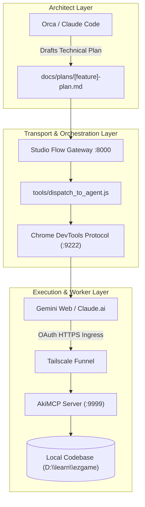

# Tools Explained: The Multi-Agent Ecosystem

A comprehensive architectural explanation of all tools, scripts, and runtime components in the **Studio Flow** and **Multi-Agent Delegation** ecosystem.

---

## 1. High-Level Collaboration

---

## 2. Core Tools & What They Do

### 1. `dispatch_to_agent` (Automated Dispatcher Tool)
- **Files**: `tools/dispatch_to_agent.js` and `tools/dispatch_to_agent.cmd`.
- **Role**: **The Courier (Zero-Copy Shipper)**.
- **How it works**:
  - Connects to Chrome via native **Chrome DevTools Protocol (CDP)** over port `9222`.
  - Automatically locates any active Web Agent tab (Gemini, Claude.ai, ChatGPT).
  - Injects the plan file path, autonomous instructions, and programmatic enter/submit events into the chatbox.
  - **Why it exists**: Eliminates manual copy-pasting of prompt text and plan paths between terminal windows and web browsers.

---

### 2. `AkiMCP` (`@akinet/akimcp`)
- **Package**: Global Node.js package running as a local-first MCP server on port `9999`.
- **Role**: **The Hands & Tools (Filesystem Engine)**.
- **Key Tool Capabilities**:
  - `aki__read_file`: Reads source files and plan specifications directly from disk.
  - `aki__write_file`: Writes newly generated assets, images, or source files.
  - `aki__edit_file`: Performs surgical replacements and diff applications on code.
  - `aki__run_cmd`: Runs approved developer commands (`bun test`, `bunx tsc --noEmit`, `git status`).
  - `aki__akidevrule_context`: Generates cryptographic receipt tokens to ensure the agent follows project rules before any file mutation.

---

### 3. `Studio Flow Gateway` (FastAPI Server)
- **File**: `server/app.py` running on `http://127.0.0.1:8000`.
- **Role**: **The Central Gateway & API Router**.
- **Endpoints**:
  - `POST /api/agent/dispatch`: The single endpoint that any external agent (Orca, Claude Code, curl) calls to hand off an implementation plan.
  - `GET /api/agent/dispatch-logs`: Serves the history of all dispatches, caller identities, and status outcomes.

---

### 4. `Agent Dispatch Logs Panel` (UI Monitor)
- **Component**: `ui/src/features/editor/components/sidebar/agent-dispatch-logs-panel.tsx`.
- **Role**: **The Control Tower (Visual Monitoring)**.
- **Features**:
  - Displays caller name (`Orca Architect`), plan filename, target model (`gemini`), and live execution status (`Success`, `Working`, `Failed`).
  - Features an embedded terminal viewer to inspect the raw output and git verification logs without needing to open the browser console.

---

### 5. Automated 1-Click Operations
- **`setup.bat`**: Automatic installer for new computers (installs npm dependencies, links `tools/` into Windows `PATH`, and deploys global skills).
- **`start-all.bat`**: Boots AkiMCP, Studio Flow, and Chrome Debug in one go.
- **`stop-all.bat`**: Cleanly shuts down background node and python processes.

---

## 3. Summary Metaphor

| Component | Real-World Metaphor | Responsibility |
| :--- | :--- | :--- |
| **Orca** | **The Architect (Kiến trúc sư)** | Analyzes requirements, checks codebase, and designs the plan. |
| **`dispatch_to_agent`** | **The Courier (Người giao hàng)** | Instantly transfers the plan into the web browser without typing. |
| **Gemini Web** | **The Builder (Thợ xây dựng)** | Reads the plan and leverages high web quotas to generate code. |
| **AkiMCP** | **The Toolset (Búa & Kìm)** | Provides safe, audited read/write/terminal access on the local disk. |
| **Studio Flow UI** | **The Control Tower (Đài chỉ huy)** | Visualizes the pipeline, node graph, and real-time dispatch logs. |
