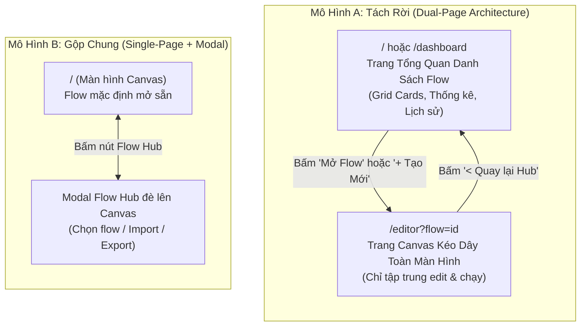
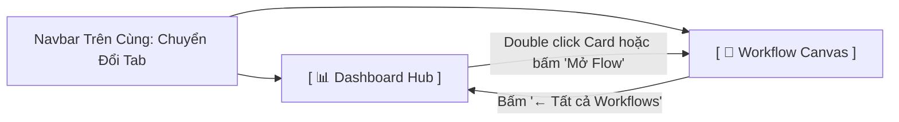

# Phân Tích Kiến Trúc Điều Hướng Studio Flow: Single-Page Canvas + Modal vs. Dual-Page Dashboard & Editor

**Tác giả**: BA Analyst & FE Architect Team  
**Dự án**: Studio Flow (`D:\learn\studio`)  
**Ngày lập**: 22/11/2026  

---

## 1. Đặt Vấn Đề

Hiện tại Studio Flow đang dùng mô hình **Single Canvas + Modal Hub**: Khi vào trang chủ là thấy ngay màn hình vẽ Canvas kéo thả, còn danh sách các workflow được mở qua Modal `Flow Hub`.

Người dùng đặt câu hỏi:
> *"Tôi tưởng trang này sẽ là dạng Dashboard và 1 trang Edit riêng biệt nhỉ? Thường cái nào tiện hơn?"*

Tài liệu này so sánh 2 mô hình kiến trúc phổ biến trong ngành Auto Flow và đề xuất giải pháp tối ưu nhất cho Studio Flow.

---

## 2. So Sánh Hai Mô Hình Kiến Trúc

### Bảng So Sánh Chi Tiết:

| Tiêu chí | Mô hình A: Tách Rời (Dashboard riêng + Editor riêng) | Mô hình B: Gộp Chung (Vào thẳng Canvas + Modal Hub) |
| :--- | :--- | :--- |
| **Ứng dụng thực tế đại diện** | **n8n, Dify, LangFlow, Make.com, Zapier** | **ComfyUI, Blender, Figma** |
| **Độ tập trung khi làm việc (Focus)** | ⭐⭐⭐⭐⭐ **Cực cao**: Khi ở Dashboard thì quản lý tổng quan. Khi vào Editor thì 100% không gian màn hình dành cho Canvas. | ⭐⭐⭐ Dễ bị phân tâm vì Canvas và Modal đè lên nhau. |
| **Không gian hiển thị danh sách Flow** | ⭐⭐⭐⭐⭐ **Rộng rãi**: Có cả trang lớn để làm bảng thống kê, tìm kiếm (Search), phân loại thư mục (Folder/Tags), xem lịch sử chạy của tất cả các flow. | ⭐⭐⭐ **Hẹp**: Bị giới hạn trong khung Modal nhỏ giữa màn hình. |
| **Chia sẻ đường dẫn (URL Deep Link)** | ⭐⭐⭐⭐⭐ **Chuẩn RESTful**: Mỗi flow có 1 URL riêng `http://localhost:5173/workflow/gemini_banner`. Gửi link cho ai là mở đúng flow đó. | ⭐⭐ Khó bookmark, F5 dễ bị về flow mặc định. |
| **Tốc độ mở flow nhanh** | Cần 1 lần chuyển trang (Client-side route). | Mở sẵn flow đầu tiên ngay khi vào web. |

---

## 3. Cái Nào Tiện Hơn Trong Thực Tế?

### ✅ Kết Luận: **MÔ HÌNH A (DASHBOARD TỔNG QUAN + TRANG EDITOR RIÊNG) TIỆN VÀ CHUYÊN NGHIỆP HƠN RẤT NHIỀU**

Lý do vì sao mọi phần mềm Auto Flow hàng đầu (n8n, Dify, Make) đều làm theo **Mô hình A**:

1. **Trải nghiệm Quản Lý (Management Experience)**:
   - Khi bạn có 10 - 20 workflow khác nhau (Flow Banner, Flow Tách Nền Hàng Loạt, Flow Tạo Avatar, Flow Bắn Telegram), trang **Dashboard** là nơi trung tâm để bạn:
     - Nhìn tổng thể hệ thống: Tổng số lần chạy hôm nay, bao nhiêu flow thành công, flow nào đang bị lỗi.
     - Tìm kiếm flow theo tên, gắn thẻ Tag (`Marketing`, `Game Asset`, `Production`).
     - Bật / Tắt trạng thái kích hoạt tự động (`Active / Inactive Switch`).
2. **Trải nghiệm Biên Tập (Editor Experience)**:
   - Khi bấm **"Chỉnh sửa"** một Flow, bạn được đưa vào trang Canvas chuyên biệt:
     - Góc trên bên trái có nút `← Quay lại Dashboard`.
     - Toàn bộ thanh công cụ tập trung 100% cho việc nối dây, chỉnh thông số node và chạy thử.
     - URL trên thanh địa chỉ thể hiện rõ ràng: `localhost:5173/workflow/ca44780d`. F5 lại vẫn ở đúng flow bạn đang sửa, không bao giờ bị mất trạng thái.

---

## 4. Thiết Kế Kiến Trúc Đề Xuất Cho Studio Flow

Không cần cài thêm thư viện Router cồng kềnh, chúng ta có thể tổ chức thành **State-based Tab / View Routing** cực kỳ mượt mà:

### 1. Màn Hình 1: Dashboard Hub View (`view === 'dashboard'`)
- **Header Thống Kê Nhanh (Metric Cards)**:
  - *Tổng số Workflow*: 5
  - *Số lượt chạy hôm nay*: 24 (96% thành công)
  - *Nút bấm chính*: **`+ Tạo Workflow Mới`**, **`Import JSON`**
- **Thanh Tìm Kiếm & Lọc**: Gõ tên để lọc nhanh flow.
- **Lưới Card Flow Rộng Rãi**:
  - Mỗi thẻ hiển thị: Tên flow, mô tả, số lượng nodes, thời gian chạy gần nhất, tag trạng thái.
  - Các nút: **Mở Editor**, **Export JSON**, **Nhân bản**, **Xóa**.

### 2. Màn Hình 2: Editor Canvas View (`view === 'editor'`)
- Nút `← Dashboard` ở góc trái thanh Navbar.
- Tên Workflow hiển thị to rõ kèm trạng thái `Saved`.
- Màn hình Canvas React Flow kéo dây toàn diện kèm thanh Sidebar cấu hình & Lịch sử chạy.

---

## 5. Đề Xuất Thực Hiện

Bạn có muốn chuyển đổi giao diện Studio Flow sang mô hình **Dashboard Hub riêng + Editor Canvas riêng** với nút chuyển đổi tab mượt mà trên Navbar không?
