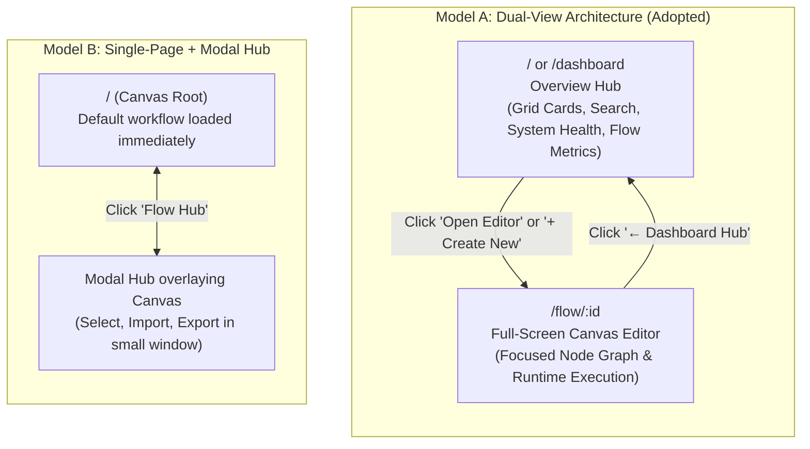

# Studio Flow Navigation Architecture: Single-Page Canvas + Modal vs. Dual-Page Dashboard & Editor

**Author**: BA Analyst & FE Architect Team  
**Project**: Studio Flow (`D:\learn\studio`)  
**Date**: November 2026  

---

## 1. Problem Statement

Studio Flow previously utilized a **Single Canvas + Modal Hub** model: Opening the root route directly mounted the React Flow canvas with a default pipeline, while other workflows were selected via a modal popup.

This document evaluates the trade-offs between two industry-standard architecture models and details why the **Dual-View Dashboard & Editor** pattern was adopted.

---

## 2. Architecture Comparison

### Comparative Breakdown:

| Criteria | Model A: Dual-View (Separate Dashboard & Editor) | Model B: Single-Page (Direct Canvas + Modal Hub) |
| :--- | :--- | :--- |
| **Industry Precedents** | **n8n, Dify, LangFlow, Make.com, Zapier** | **ComfyUI, Blender, Pure Figma** |
| **Workflow Focus** | ⭐⭐⭐⭐⭐ **High**: Dashboard focuses on project discovery; Editor dedicates 100% viewport to node connections. | ⭐⭐⭐ Modal overlays canvas, causing visual clutter. |
| **Workspace Scalability** | ⭐⭐⭐⭐⭐ **Expansive**: Full-screen grid cards, search filters, node counts, and run histories. | ⭐⭐⭐ **Constrained**: Restricted to modal dialog dimensions. |
| **URL Deep Linking** | ⭐⭐⭐⭐⭐ **RESTful**: `/dashboard` and `/flow/:id` allow bookmarks and direct links without losing context on refresh. | ⭐⭐ Browser refresh resets back to default pipeline. |
| **Resource Efficiency** | ⭐⭐⭐⭐⭐ **Fast**: Dashboard renders lightweight cards; React Flow mounts only when entering Editor. | Heavy: Mounts full canvas with all event listeners on initial load. |

---

## 3. Conclusion & Implementation

**Model A is strictly adopted** for Studio Flow:
1. Navigating to `/` displays the **Dashboard View** with instant search, creation cards, and workflow stats.
2. Selecting any workflow smoothly navigates to `/flow/:id` mounting the full **Editor View** with top navbar actions and collapsible sidebars.
3. The `← Dashboard Hub` button in the top navbar provides instant, zero-friction return navigation.
