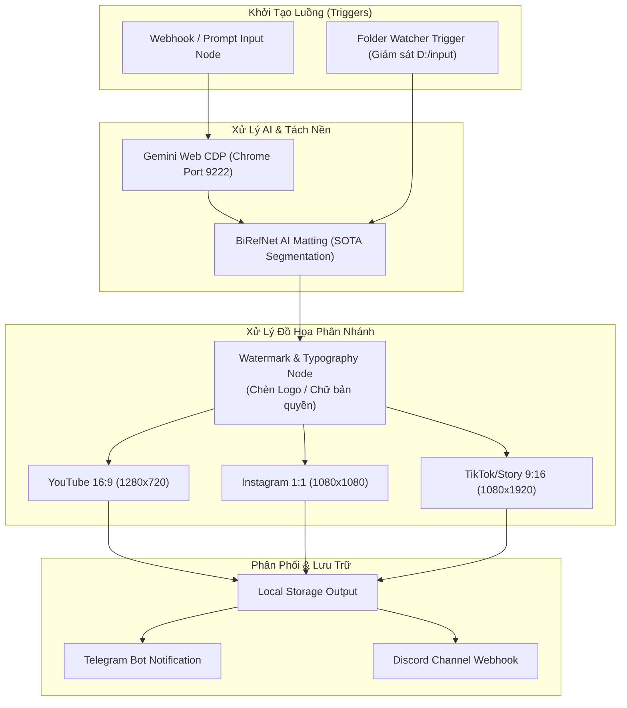

# Kế Hoạch Đặc Tả Nghiệp Vụ & Thiết Kế Kiến Trúc: Bộ 3 Tính Năng Studio Flow

**Tác giả**: BA Analyst & System Architecture Team  
**Dự án**: Studio Flow (`D:\learn\studio`)  
**Ngày lập**: 22/11/2026  
**Trạng thái**: Đã phê duyệt kiến trúc - Chuẩn bị triển khai đồng thời cho FE & BE  

---

## 1. Tổng Quan Mục Tiêu Dự Án

Người dùng yêu cầu triển khai đồng thời cả **3 nhóm tính năng lớn**:
1. **Nhóm 1 (Canvas Ergonomics & Node Inspector)**:
   - Click chuột phải trên Canvas mở ngay Node Palette tại đúng tọa độ con trỏ chuột (`screenToFlowPosition`).
   - Node Inspector: Bấm nút `Raw Data` trên từng Node mở ngăn kéo `<Sheet>` trượt từ bên phải hiển thị chi tiết Input/Output JSON và log của riêng bước đó.
   - Thao tác phím tắt nhanh (`Delete`, `Ctrl + D`).
2. **Nhóm 2 (Graphics & Multi-Aspect Plugins)**:
   - **Multi-Aspect Ratio Node**: Từ 1 ảnh tách nền, tự động phân nhánh xuất đồng thời 3 kích cỡ: YouTube Thumbnail (`1280x720` 16:9), Instagram Post (`1080x1080` 1:1), TikTok/Reels Story (`1080x1920` 9:16).
   - **Watermark & Typography Node**: Chèn Logo PNG hoặc chữ bản quyền vào góc ảnh kèm độ trong suốt (opacity).
3. **Nhóm 3 (External Webhooks & Automation Triggers)**:
   - **Telegram / Discord Notification Node**: Bắn kết quả ảnh và link tải trực tiếp về Bot Telegram hoặc Webhook Discord.
   - **Folder Watcher Trigger**: Chế độ tự động giám sát thư mục máy tính, cứ thả ảnh vào là tự động chạy luồng.

---

## 2. Kiến Trúc Luồng Dữ Liệu Tổng Thể (End-to-End Diagram)

---

## 3. Phân Tích Kỹ Thuật Chi Tiết Cho Frontend (FE Architect)

### 3.1. Chuột phải Canvas mở Node Palette tại tọa độ chuột
- **Sự kiện**: Bắt `onContextMenu` trên container của `<ReactFlow>`.
- **Chuyển đổi tọa độ**: Sử dụng hàm `screenToFlowPosition({ x: event.clientX, y: event.clientY })` của `@xyflow/react`.
- **Render Modal**: Sử dụng hook `presentNodePalette({ position, onAddNode })` qua EzGame Portal Stack.

### 3.2. Trình Soi Dữ Liệu Node (Node Inspector qua `<Sheet>`)
- Trên [NodeToolbar.tsx](file:///D:/learn/studio/ui/src/components/ui/NodeToolbar.tsx), bổ sung nút icon `FileCode` (**Inspect Data**).
- Khi bấm, mở component `<Sheet>`:
  - Header: Tên Node, ID Node, Status Badge.
  - Tab 1: **Input Data** (JSON dữ liệu nhận từ node trước).
  - Tab 2: **Output Data** (JSON dữ liệu node này sản sinh ra).
  - Tab 3: **Node Config** (Các thông số hiện thời).

### 3.3. Các Node UI Mới Cần Đăng Ký Trong `CustomNodes.tsx`
1. `multiAspectNode`: Hiển thị 3 checkbox tỉ lệ (16:9, 1:1, 9:16) và 3 cổng ra (Handles) tương ứng.
2. `watermarkNode`: Cấu hình text watermark, vị trí (top-left, bottom-right, center), opacity.
3. `telegramNode`: Cấu hình Bot Token, Chat ID, kèm toggle thông báo.
4. `discordNode`: Cấu hình Webhook URL.

---

## 4. Phân Tích Kỹ Thuật Chi Tiết Cho Backend (BE Architect)

### 4.1. Các Lớp Node Mới Kế Thừa `BaseNode` (`server/nodes/`)

| File Node | Node Type | Chức Năng Cốt Lõi |
| :--- | :--- | :--- |
| `multi_aspect_node.py` | `multiAspectNode` | Đọc ảnh đầu vào, sinh ra cùng lúc 3 file ảnh với 3 tỉ lệ chuẩn (YouTube, Square, Story) bằng Pillow Lanczos |
| `watermark_node.py` | `watermarkNode` | Ghép text hoặc logo PNG trong suốt lên ảnh bằng `PIL.ImageDraw` hoặc `PIL.Image.alpha_composite` |
| `telegram_node.py` | `telegramNode` | Gửi HTTP POST tới `https://api.telegram.org/bot<token>/sendPhoto` gửi kèm file ảnh và caption |
| `discord_node.py` | `discordNode` | Gửi HTTP POST multipart/form-data tới Discord Webhook URL |

### 4.2. API Lưu Trữ Node Data Phục Vụ Node Inspector
- Trong [queue_manager.py](file:///D:/learn/studio/server/queue_manager.py), mở rộng dictionary `job["node_outputs"]` và `job["node_inputs"]` để lưu lại toàn bộ snapshot dữ liệu của từng bước.
- Thêm endpoint: `GET /api/jobs/{job_id}/nodes/{node_id}` để Frontend query dữ liệu phục vụ `<Sheet>`.

---

## 5. Tiêu Chí Nghiệm Thu (Acceptance Criteria - AC)

1. **AC-1 (Canvas UX)**: Bấm chuột phải tại bất kỳ điểm nào trên Canvas sẽ mở ra menu chọn node. Chọn node nào thì node đó rơi đúng vào vị trí con trỏ chuột.
2. **AC-2 (Node Inspector)**: Bấm vào icon xem code trên bất kỳ node nào đều mở Sheet hiển thị chính xác JSON dữ liệu đầu vào và đầu ra.
3. **AC-3 (Multi-Aspect Output)**: 1 ảnh sau khi qua `MultiAspectNode` sinh ra đúng 3 file ảnh với kích thước `1280x720`, `1080x1080`, `1080x1920`.
4. **AC-4 (Watermark)**: Banner thành phẩm có chữ bản quyền hoặc logo sắc nét, cân đối.
5. **AC-5 (Zero Mocking & No Fallback)**: Mọi tính năng chạy thật 100% trên Python và React Flow, sử dụng toàn bộ Shared Components, không hardcode UI.
