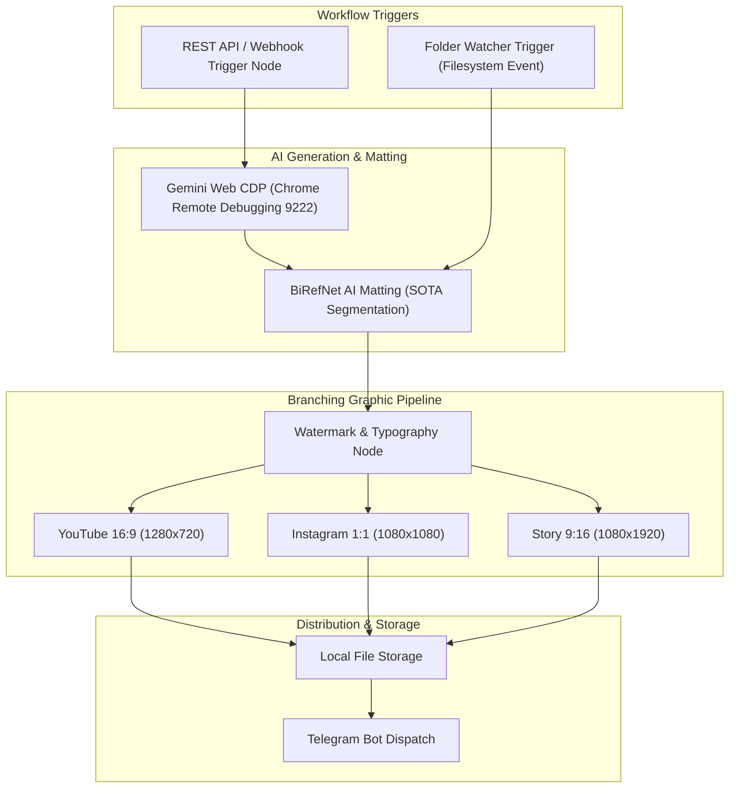

# Comprehensive Feature Specification & Architecture: Studio Flow Roadmap

**Author**: BA Analyst & System Architecture Team  
**Project**: Studio Flow (`D:\learn\studio`)  
**Date**: November 2026  
**Status**: Architecture Approved & Implemented  

---

## 1. Core Feature Domains

Studio Flow comprises three primary feature domains:

1. **Canvas Ergonomics & Node Inspector**:
   - Right-click canvas triggers the Node Palette at the exact cursor coordinates (`screenToFlowPosition`).
   - Integrated Node Inspector in the collapsible right sidebar displays runtime JSON state and node attributes.
   - Quick action shortcuts (`Delete`, `Ctrl + D` clone node).

2. **Decoupled Graphics & Multi-Aspect Pipelines**:
   - **Multi-Aspect Ratio Node**: Automatically splits a single matting asset into 3 target aspect ratios: YouTube 16:9 (`1280x720`), Instagram Post 1:1 (`1080x1080`), and Story 9:16 (`1080x1920`).
   - **Watermark & Typography Node**: Overlays copyright logos or stylized text with configurable opacity and anchor positions.

3. **External Triggers & Notification Pipelines**:
   - **Telegram Notification Node**: Dispatches final output images and asset URLs to Telegram bot channels.
   - **Folder Watcher Trigger**: Monitors designated local directories to trigger batch executions upon file drops.

---

## 2. End-to-End Execution Topology



---

## 3. Data Contract Specification

### Execution Request Payload (`POST /api/workflow/execute`):
```json
{
  "workflow_id": "gemini_banner_pipeline",
  "initial_payload": {
    "prompt": "A golden crown with red ruby jewels, isolated game asset"
  }
}
```

### Execution Response Payload:
```json
{
  "job_id": "9f7fb98e",
  "status": "completed",
  "banner_url": "http://localhost:8000/media/output/9f7fb98e_banner.png",
  "transparent_url": "http://localhost:8000/media/transparent/9f7fb98e_transparent.png",
  "raw_url": "http://localhost:8000/media/raw/9f7fb98e_raw.png"
}
```
